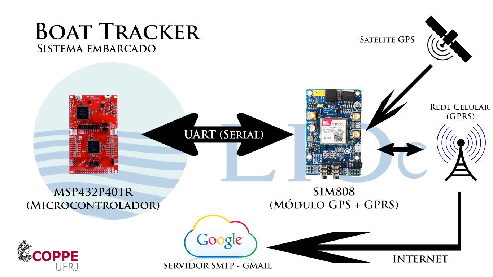

<div align="center">


# boat-tracker

<sub>GPS by e-mail · 2017 · DEL/POLI/UFRJ, for LIOC · <a href="#what-it-needs">what it needs</a> · <a href="#how-to-cite">cite</a></sub>

[](#archive-notice)
[](#what-it-needs)
[](#what-it-needs)
[](#what-it-needs)
[](.github/workflows/tests.yml)
[](#about-the-text)

</div>

> [!WARNING]
> **Archive notice.** This repository is not maintained. Do not use it as a base for new work.
> It is a record of my part in a student project. The project was "Projeto Integrado 2017.1"
> at DEL/POLI/UFRJ. LIOC (COPPE/UFRJ) paid for the hardware.

## in one minute

- **The tracker tells where a boat is.** A GPS module finds the position of the boat. A
  microcontroller sends the position by e-mail through the 2G network.
- **A script on land reads the e-mails.** It parses each GPS sentence and writes a line in a
  log file. There is one log file for each day.
- **A web page shows the position.** The PHP page reads the last log file. It shows the last
  position on a Google map.
- **The parts cost about R$ 250.** The project report has the prices of 2017.
- **The work stopped in August 2017.** The last code commit is "Commit Final da Versão 1.0".

## where to start

| If you want to | Go to |
|---|---|
| read the project report (Portuguese) | [`doc/BoatTracker.tex`](doc/BoatTracker.tex) |
| see the diagram | [`doc/Diagrama_Funcionamento_Sist_Emb.png`](doc/Diagrama_Funcionamento_Sist_Emb.png) |
| see the code of the microcontroller | [`proj/embeddedsystem/src/emb.ino`](proj/embeddedsystem/src/emb.ino) |
| see the script that reads the e-mails | [`proj/earthsystem/src/back/gmailtotxt.py`](proj/earthsystem/src/back/gmailtotxt.py) |
| see the web page | [`proj/earthsystem/src/front/trackermap.php`](proj/earthsystem/src/front/trackermap.php) |
| see the logs of the tests in 2017 | [`proj/earthsystem/logs/`](proj/earthsystem/logs/) |
| do the checks | [tests](#tests) |

## how it works

[](doc/Diagrama_Funcionamento_Sist_Emb.png)

The project has two systems.

| System | Runs on | Code | What it does |
|---|---|---|---|
| embedded | MSP432P401R and SIM808 | `proj/embeddedsystem/` | It reads the GPS and sends the position by e-mail. |
| land | a computer with Python and PHP | `proj/earthsystem/` | It reads the e-mails, writes the logs and shows the map. |

The steps are:

1. The SIM808 module gets a `$GPRMC` sentence from the GPS satellites.
2. The MSP432 reads the sentence through a serial port (UART).
3. The MSP432 sends AT commands to the SIM808. The SIM808 sends the sentence by e-mail.
4. `gmailtotxt.py` reads the unread e-mails of the tracker's mailbox through IMAP.
5. The script parses the sentence and adds a line to the log file of the day.
6. `trackermap.php` reads the last log file and shows the last position on the map.

### the log format

The name of a log file is `<tracker>_<date>`, for example `BT01_2017-06-28`. Each line is one
position:

```text
latitude,longitude,date,time,status,speed
-22.8609416667,-43.2277616667,2017-06-28,13:24:49,A,0.18
```

The latitude and the longitude are in decimal degrees. The status `A` means a valid position.
The speed is in knots. The logs before 2017-06-27 have older formats.

## what it needs

### the embedded system

- the TI LaunchPad MSP-EXP432P401R
- a SIM808 GSM/GPRS/GPS module, with a SIM card and a 2G data plan
- Energia, the Arduino-like environment for TI LaunchPads, to compile the `.ino` files

The `.ino` files use the pin names of Energia (for example `RED_LED`). We did not compile them
again in 2026.

### the land system

- Python 3.9 or later, with the packages in [`requirements.txt`](requirements.txt)
- a web server with PHP, for example XAMPP
- a Google Maps JavaScript API key

The script was written for Python 2 in 2017. Since 2026 it runs on Python 3, with `pynmea2`
1.19.0. It reads the mailbox user and password from the environment. It writes the same log
lines as before.

To start the land system:

1. Install the packages:

   ```sh
   python3 -m pip install -r requirements.txt
   ```

2. Set the mailbox user and password:

   ```sh
   export BT_MAIL_USER=<mailbox>
   export BT_MAIL_PASSWORD=<app password>
   ```

3. Start the script in the folder of the web page:

   ```sh
   python3 proj/earthsystem/src/back/gmailtotxt.py
   ```

4. Set `GOOGLE_MAPS_KEY` in the environment of the web server.
5. Open `trackermap.php` in the browser.

> [!CAUTION]
> Do not write a password or a key in a file of this repository. Use the environment.

## tests

The tests cannot send an e-mail or use the hardware. They check the script and the repository:

- the script makes the same log line as the logs of 2017
- the script finds the `$GPRMC` sentence in an e-mail body
- the logs of 2017-06-27 and later have six fields in each line
- the files contain no password, no API key and no phone number
- the PHP pages read the map key from the environment
- the README has the archive notice, and its sentences are not too long

To do the checks, use these commands:

```sh
python3 -m pip install -r requirements.txt
python3 -m unittest discover -s tests -v
```

The workflow `.github/workflows/tests.yml` does the same checks.

## about the text

The text in this README follows ASD-STE100, Simplified Technical English, Issue 9. The
[tests](#tests) check one rule only: the length of a sentence. A person must check the other
rules and the dictionary. The code comments, the commit messages and the report do not follow
ASD-STE100. They are in Portuguese.

## authors

- William Barbosa de Macedo
- Matheus Hoffmann ([@h0ffmann](https://github.com/h0ffmann))

The professors of the course were Carlos José Ribas D'ávila (Casé) and Joarez Bastos Monteiro.

The original repository is `lioc-coppe/BoatTracker`. It is private. This repository is a copy of
it, with its full history. Before we published the copy, we removed these items from all the
commits:

- the password of the mailbox
- the Google Maps API key
- the phone numbers
- the PDF files and the LaTeX build files of the report, because they contain the password

## how to cite

This repository has no DOI. Cite it as software:

> Macedo, W. B., & Hoffmann, M. (2017). *Boat Tracker: GPS by e-mail on MSP432 and SIM808*
> [Computer software]. https://github.com/h0ffmann/boat-tracker

My other works with a DOI:

- marola: [10.5281/zenodo.23224155](https://doi.org/10.5281/zenodo.23224155)
- ww3-gpu: [10.5281/zenodo.23221351](https://doi.org/10.5281/zenodo.23221351)
- picasso: [10.5281/zenodo.23311208](https://doi.org/10.5281/zenodo.23311208)
- closed source: [10.5281/zenodo.23333656](https://doi.org/10.5281/zenodo.23333656)
- marola-bench: [10.5281/zenodo.23352633](https://doi.org/10.5281/zenodo.23352633)
- nashkell, the open book: [10.5281/zenodo.23356739](https://doi.org/10.5281/zenodo.23356739)

## licensing

This repository has no licence. All rights stay with the authors. These parts are from other
authors and stay under their licences:

- NeoGPS, by SlashDevin, in `proj/embeddedsystem/libraries/NeoGPS-master/`
- siimple 2.0.1 and the XAMPP dashboard, in `proj/earthsystem/src/front/`
- the LaTeX title page template of LaTeXTemplates.com (CC BY-NC-SA 3.0), in `doc/BoatTracker.tex`
